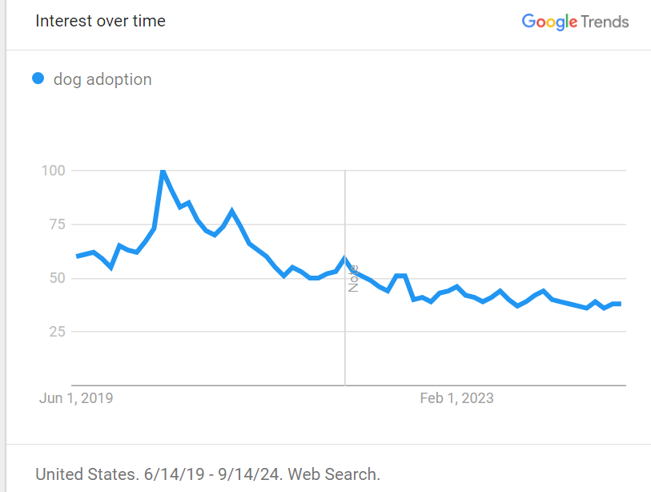
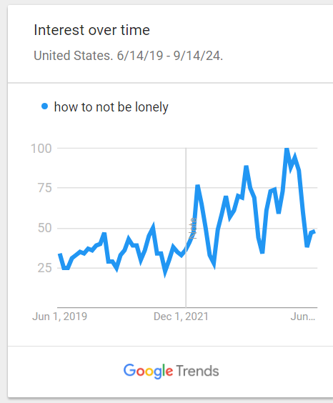
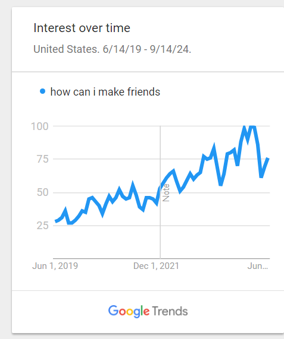
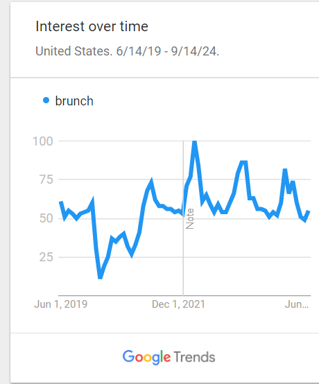

# Has Social Distancing Brought Us Closer Together?

A look at how Americans' social behavior changed after the COVID-19 lockdowns, using Google Trends search data and national surveys.

**DSC 500 Introduction to Data Science · Bellevue University · James Robinson · September 2024**

---

## The Question

In March 2020, states began shutting down schools, restaurants and bars to slow the spread of COVID-19. Social distancing threatened people's sense of community and their basic need to socialize. Four years later, has that time apart pushed people away from each other, or made them want connection more than before?

## What I Found

- **People turned to companionship right away.** Google searches for "dog adoption" hit their highest point of the five-year window in March–April 2020, and one in five U.S. households got a cat or dog between March 2020 and May 2021 (ASPCA, 2021).
- **Loneliness rose.** Studies found about a 5% increase in loneliness in North America and Europe (Ernst, 2022), and 59% of U.S. adults surveyed said forming relationships had become harder since the pandemic (Davis, 2022).
- **People started looking for connection.** Searches for "how to not be lonely" and "how can I make friends" reached levels not seen before the pandemic.
- **And they found it.** The 2022 U.S. marriage rate (6.2 per 1,000) was the highest since 2018 (Tsai, 2024), run clubs and book clubs boomed, and Saturday brunch became restaurants' busiest time slot, with "brunch" searches also reaching new highs.

| Dog adoption | How to not be lonely |
|---|---|
|  |  |
| **How can I make friends** | **Brunch** |
|  |  |

*Google Trends, United States, June 2019 – September 2024.*

## Conclusion

More than four years after the first lockdowns, people are leaning into face-to-face connection, even more than before the pandemic. As restrictions lifted, Americans have been building a "new normal" centered on community and belonging.

## Data Sources

- **Google Trends:** U.S. web search interest for "dog adoption," "how to not be lonely," "how can I make friends" and "brunch," June 2019 – September 2024
- **Surveys and reports:** ASPCA (2021), Forbes Health (Davis, 2022), CivicScience and Newsweek (Kim, 2023), American Psychological Association (Ernst, 2022), CDC (2023; Tsai, 2024), and others cited in the paper

## Limitations and Next Steps

- Google Trends shows relative search interest, not how many people searched, and searching for something doesn't mean doing it.
- The data is national. Lockdown length and strictness varied by state, so a state-level breakdown of search trends and surveys could show whether places with longer shutdowns saw bigger changes.
- A larger survey that records where respondents live would allow cross-referencing with search data to look for stronger evidence of cause and effect.

## Repository Contents

```
├── README.md
├── figures/          # Google Trends charts
└── reports/
    ├── paper.pdf     # full research paper with references
    └── slides.pdf    # presentation
```
